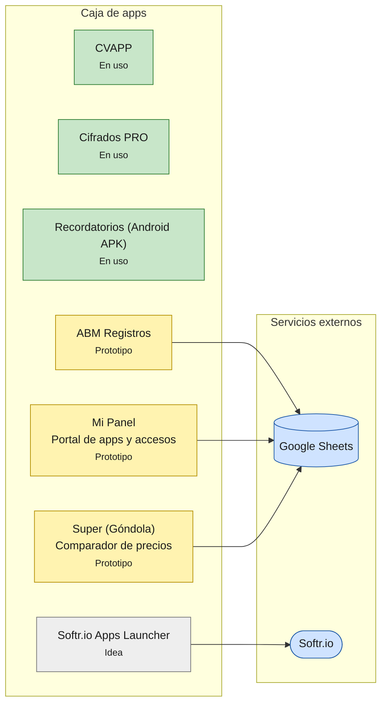

# Mapa de mi caja de apps

**Referencias:** verde = En uso · amarillo = Prototipo · gris = Idea · azul = servicio externo

| App | Estado | Se conecta con | Repo |
|---|---|---|---|
| CVAPP | En uso | — | [cvapp](https://github.com/luchorcompartidos/cvapp) |
| Cifrados PRO | En uso | — | [cifrados](https://github.com/luchorcompartidos/cifrados) |
| Recordatorios (Android APK) | En uso | — | [recordatorios](https://github.com/luchorcompartidos/recordatorios) |
| ABM Registros | Prototipo | Google Sheets | [abm](https://github.com/luchorcompartidos/abm) |
| Mi Panel (Portal de apps y accesos) | Prototipo | Google Sheets | [home](https://github.com/luchorcompartidos/home) |
| Softr.io Apps Launcher | Idea | Softr.io | [softrapps](https://github.com/luchorcompartidos/softrapps) |
| Super (Góndola) | Prototipo | Google Sheets | [super](https://github.com/luchorcompartidos/super) |
