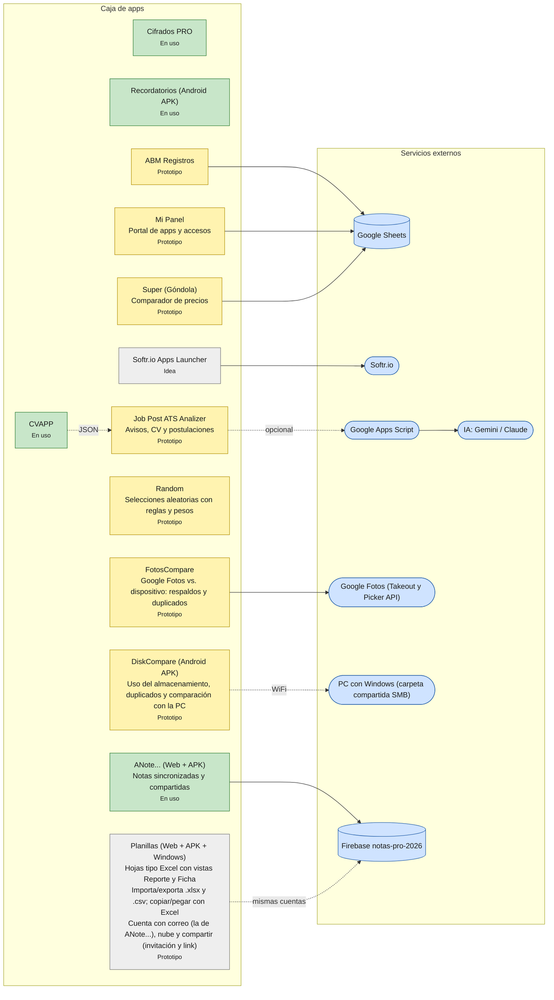

# Mapa de mi caja de apps

**Referencias:** verde = En uso · amarillo = Prototipo · gris = Idea · azul = servicio externo

| App | Estado | Se conecta con | Repo |
|---|---|---|---|
| CVAPP | En uso | — | [cvapp](https://github.com/luchorcompartidos/cvapp) |
| Cifrados PRO | En uso | — | [cifrados](https://github.com/luchorcompartidos/cifrados) |
| Recordatorios (Android APK) | En uso | — | [recordatorios](https://github.com/luchorcompartidos/recordatorios) |
| ABM Registros | Prototipo | Google Sheets | [abm](https://github.com/luchorcompartidos/abm) |
| Mi Panel (Portal de apps y accesos) | Prototipo | Google Sheets | [home](https://github.com/luchorcompartidos/home) |
| Softr.io Apps Launcher | Idea | Softr.io | [softrapps](https://github.com/luchorcompartidos/softrapps) |
| Super (Góndola) | Prototipo | Google Sheets | [super](https://github.com/luchorcompartidos/super) |
| Job Post ATS Analizer | Prototipo | IA opcional (Gemini o Claude, vía Apps Script); importa el JSON de CVAPP | [jobpost](https://github.com/luchorcompartidos/jobpost) |
| Random | Prototipo | — | [random](https://github.com/luchorcompartidos/random) |
| FotosCompare | Prototipo | Google Fotos (Takeout y Picker API, con el proyecto de Google Cloud de multigdrive) | [fotoscompare](https://github.com/luchorcompartidos/fotoscompare) |
| DiskCompare (Android APK) | Prototipo | Carpeta compartida de Windows por WiFi (SMB, solo lectura) | [diskcompare](https://github.com/luchorcompartidos/diskcompare) |
| ANote... (Web + Android APK) | En uso | Firebase (proyecto notas-pro-2026) | [notas](https://github.com/luchorcompartidos/notas) |
| Planillas (nombre a definir; Web + APK + Windows) | Prototipo (v0.0.12) | Importa/exporta Excel (.xlsx) y CSV; Firebase (notas-pro-2026, mismas cuentas que ANote...: inicio con correo desde la v0.0.9, nube desde la v0.0.10, compartir por invitación desde la v0.0.11 y por link con pedido de acceso desde la v0.0.12; reglas en un bloque propio junto a las de ANote...) | [planillas](https://github.com/luchorcompartidos/planillas) |
